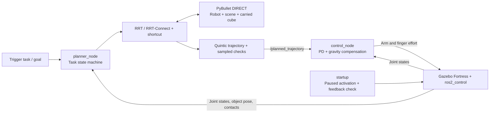

# Franka Panda: collision-aware pick and place

A ROS 2 Humble / Gazebo Fortress learning project connecting sampling-based motion planning to a physical gripper and a custom joint torque controller. The focus is understanding the complete pipeline, its failure modes, and the effect of practical improvements.

**Current result:** a full pick–place–return cycle was demonstrated in the simpler scene. In the current complex scene, physical pickup, obstacle-aware transfer and placement were demonstrated, but a return-home search timed out in the extended test. This is a simulation prototype, with no real-robot validation.

[中文探索与优化记录](docs/development_journey.md) · [Validation and limitations](docs/validation.md) · [抓取操作说明](docs/pick_and_place.md) · [复杂环境](docs/complex_world.md)

## Architecture



Gazebo is the single visible simulation. PyBullet runs without a GUI as a collision/kinematics backend. Planning, control and startup are separate ROS nodes; search, trajectory generation and collision checking are Python modules within the planner process.

## Run

Tested with Ubuntu 22.04, ROS 2 Humble and Gazebo Fortress. Use system Python with ROS, and leave Conda's base environment if it overrides Python libraries.

```bash
sudo apt update
sudo apt install ros-humble-ros-gz ros-humble-gz-ros2-control \
  ros-humble-ros2-control ros-humble-ros2-controllers \
  ros-humble-xacro ros-humble-robot-state-publisher \
  python3-colcon-common-extensions python3-pip python3-numpy \
  python3-scipy python3-pytest
/usr/bin/python3 -m pip install --user pybullet==3.2.7

git clone https://github.com/Jason-Zhang-Pro/Frank-Panda-Simulation.git
cd Frank-Panda-Simulation
source /opt/ros/humble/setup.bash
colcon build --base-paths src --symlink-install
./start.sh
```

The launch sequence configures controllers, activates them while stepping the paused simulator, waits for valid feedback and holding effort, then starts simulation. Run only one effort controller publisher. `./start.sh gui:=false` supports headless execution.

In a second terminal, from the cloned directory:

```bash
source /opt/ros/humble/setup.bash
source install/setup.bash
ros2 service call /pick_and_place std_srvs/srv/Trigger '{}'
ros2 topic echo /planner_status --qos-durability transient_local
```

A successful Trigger response means **accepted**, not completed. Follow `/planner_status` for task progress, failures and final completion. Do not paste printed responses or logs back into the shell as commands.

## Planning and execution

- Default: bidirectional RRT-Connect, 15 s search budget, 0.15 rad step, 0.02 rad edge sampling, optional collision-checked shortcut (150 attempts / 2 s).
- Seven arm joints are searched in joint space. Both the robot and attached cube are checked during transfer and return. Short vertical pickup/placement segments use local IK and checked interpolation.
- Rest-to-rest quintic segments stop at each retained waypoint. Velocity is limited to 20% of model limits; acceleration is limited to 0.6 rad/s². This is neither time-optimal planning nor blended waypoint tracking.
- Control uses `Kp(q_ref-q) + Kd(dq_ref-dq) + g(q)` with torque limits. Finger effort commands are capped at 5 N per finger; this is not a measured contact force.
- The scene contains 27 geometric bodies, including the floor, tables and dynamic cube. The actual cube pose and finger contacts come from Gazebo.

Parameters can be set after startup, before requesting a task:

```bash
ros2 param set /panda_planner rrt_seed 3
ros2 param set /panda_planner planner_algorithm rrt_connect
ros2 param set /panda_planner shortcut_enabled true
# For the original single-tree comparison:
# ros2 param set /panda_planner planner_algorithm rrt
```

Changing the seed reproduces search randomness only; physical simulation and execution are not guaranteed deterministic. The earlier simple scene is preserved in `examples/scenes/simple/`; replace both current world files together and restart to use it.

## Source map

| Path | Responsibility |
|---|---|
| `src/panda_planning/panda_planning/path_planner.py` | RRT, RRT-Connect and shortcut |
| `src/panda_planning/panda_planning/collision_checker.py` | FK/IK, self/environment and payload collision checks |
| `src/panda_planning/panda_planning/trajectory_planner.py` | Quintic timing and trajectory checks |
| `src/panda_planning/panda_planning/grasp_task.py` | Physical pick/place/return state machine |
| `src/panda_planning/panda_planning/control_node.py` | Arm PD/gravity and finger effort control |
| `src/panda_planning/panda_planning/startup.py` | Paused simulator/controller startup coordination |
| `src/franka_description` | Panda description, meshes and actuated gripper |

## Verify

After building and sourcing `install/setup.bash`:

```bash
/usr/bin/python3 -m pytest src/panda_planning/test -m 'not linter' -q
```

These are offline functional checks, not a full Gazebo acceptance test. Generated lint scaffolds are retained and excluded by this command; no clean lint result is claimed. See [validation](docs/validation.md) for the physical experiments and their limits.

## Known limitations

Collision checking is discretized, not a continuous collision guarantee. Meshes use conservative convex hulls. Static obstacles are loaded from the world file; moving them in the GUI does not update the planner. The dynamic cube is synchronized separately. A failed carrying task retains its payload state and rejects a new task; cancel/recovery is not yet implemented. Restart the scene to reset such a task. Complex-scene return planning remains an open issue.

## Attribution

Developed as a learning and integration project with AI-assisted implementation and debugging. RRT/RRT-Connect are established algorithms, not proposed here as new algorithms. Franka mesh provenance, upstream license and modifications are recorded in [THIRD_PARTY_NOTICES.md](THIRD_PARTY_NOTICES.md). Original project code currently has no general reuse license; third-party licenses remain applicable.
